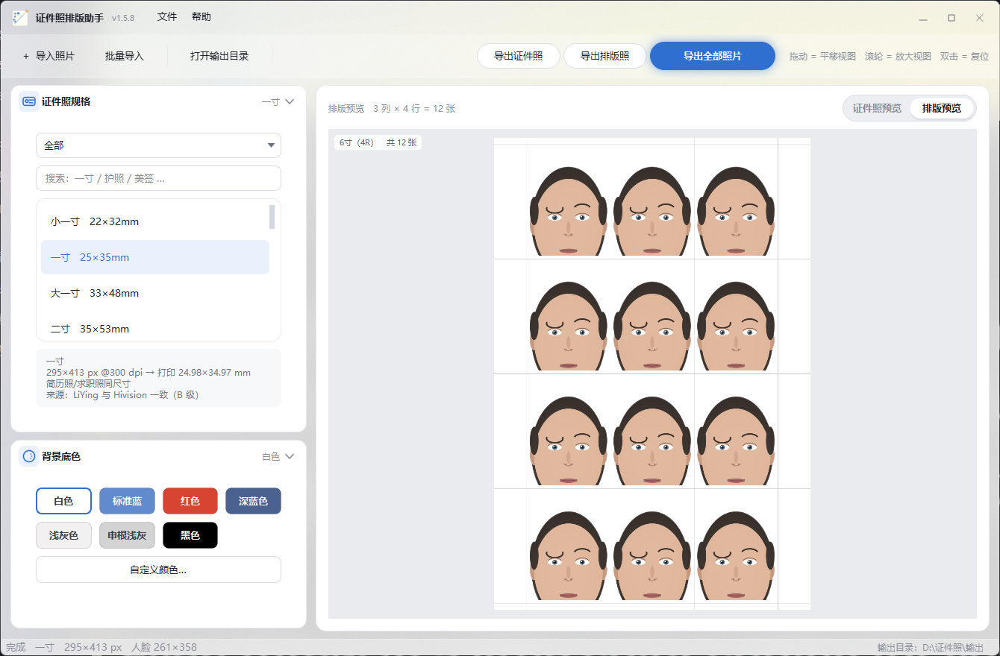
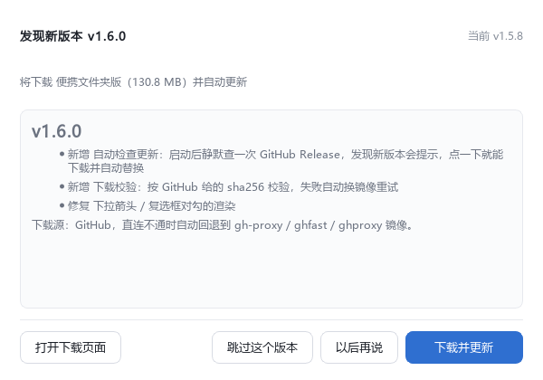

# 证件照排版助手

> Windows 桌面证件照工具：**导入一张照片 → 自动抠图换底色 → 按证件照规格裁剪 → 排版到 5/6/7 寸相纸 → 导出可直接拿去冲印的文件。**
>
> **照片全程在本机处理**，不会上传到任何地方；模型在本机 CPU 上推理，不写注册表。
> 唯一会联网的地方是「检查更新」（只向 GitHub 取一个版本号），可在「帮助」菜单里关掉。



> 截图里的示例人像是**合成头像**（[`scripts/make_demo_face.py`](scripts/make_demo_face.py) 画的扁平插画），
> 不含任何真人的形象；测试也用它当样例照片。

---

## 功能

**自动抠图换底**
- 人像抠图（MODNet）+ 人脸检测（MTCNN）在本机推理，CPU 约 1 秒/张
- 底色：白 / 标准蓝 / 红 / 深蓝 / 浅灰 / 申根浅灰 / 黑，以及任意自定义颜色
- 抠图内部空洞修补（发丝、肩膀半透明边）默认开启

**规格库（40 条，每条都带来源与可信度）**
- 常用：小一寸 22×32、一寸 25×35、大一寸 33×48、二寸 35×53、三寸 55×84、身份证 26×32、五寸生活照…
- 护照签证：中国护照、港澳/台湾通行证、申根、美/日/韩/英/加/澳/新西兰…
- 考试报名：人事考试网、教资 NTCE、护士、研招网、国考、四六级、JLPT…（带官方文件大小要求）
- **一个物理尺寸只保留一条通用规格**；别的叫法（驾照、社保卡、小二寸、35×49…）放在**别名**里，搜索框照样搜得到

**排版引擎（自研）**
- 相纸：5 寸(3R) / 6 寸(4R) / 7 寸(5R) / A4 / A3，全部按真实毫米尺寸计算
- 自动搜索「列 × 行」，并比较 90° 旋转后的方案，取张数最多的那种
  （实测比上游 HivisionIDPhotos 写死 3 行的实现多排一倍：A4 上一寸 50 张 vs 21 张）
- 照片间距、纸张留边、裁剪线（贯穿延长线 / 独立方框 / 不画）可调
- 整块在纸面居中；导出时**每张照片的物理毫米尺寸永远等于规格尺寸**

**构图与预览**
- 滑块微调：缩放、上下/左右位置、旋转 0.1°、人脸占高、脸部垂直位置
- 预览：滚轮放大视图（1×~8×，以光标为锚点）、拖动平移视图；**Ctrl + 拖动** 才是挪照片构图
- 把图片拖进窗口即可导入

**导出**
- dpi 逐张写入并**回读校验**（一寸 295×413px 若被标成 350dpi，打印出来会小 8.5%）
- 报名系统的文件大小上下限：二分搜索 JPEG 质量；不足下限时用合法 COM 段填充（不是往文件里塞垃圾）
- 换输出分辨率时像素跟着缩放，**打印尺寸恒定**（不会出现选 600dpi 打出来只有一半大的坑）
- 批量导入 / 批量导出；左列卡片摘要实时显示当前规格、底色、相纸张数、分辨率

**自动更新**



- 启动后静默检查新版本（24 小时一次），发现更新会展示版本说明，点一下就下载并自动替换、
  自动重启到新版本；不想更可以「以后再说」或「跳过这个版本」
- **多源测速**：同时探测「GitHub」和自建节点（静态 `update.json`），**用延迟最低的那个下载**，
  它失败了自动换下一个；对话框里会显示每个源的延迟
- 下载走 GitHub（直连不通自动回退镜像）或自建节点；下载后按 `sha256` 校验
- 可以在「帮助」菜单里关掉自动检查（关掉后程序完全不联网），`IDPHOTO_NO_UPDATE=1` 也能一票否决

### 自建更新节点（国内下载更快）

程序支持把更新包放在自己的服务器上，检查更新时和 GitHub 一起测速、谁快用谁。
默认已经指向作者自己的节点，想换成自己的就这样：

```powershell
# 1. 打包（产出 成品软件\ 里的三个产物）
.\scripts\package_release.ps1

# 2. 生成节点需要的文件 → 成品软件\update\（update.json + 三个 ASCII 命名的包）
.\.venv\Scripts\python.exe scripts\make_update_manifest.py --notes-file notes.md

# 3. 推到服务器（SSH；默认用 ~/.ssh/id_ed25519 公钥，没有公钥才读 SSH_PASS 环境变量）
.\.venv\Scripts\python.exe scripts\push_update_node.py --install-key
.\.venv\Scripts\python.exe scripts\push_update_node.py

# 4. 自检（脚本最后会自动做）：确认 <节点>/update.json 能匿名访问、版本号对得上
```

`package_release.ps1` 默认在打包收尾时**自动执行 2~4 步**（`-SkipNode` 可跳过）。

节点地址写在**程序目录**的 `settings.json` 里（可以写多个，每个都会参与测速）：

```json
{ "update_sources": ["http://8.133.208.128/update/update.json"] }
```

> 节点必须能**匿名**访问（云盘面板要登录的话不行，要用静态目录或直链）；
> `update.json` 里是相对路径，整目录搬走不用改内容；
> 包名必须以 `-portable.zip` / `-onefile.exe` / `-setup.exe` 结尾（程序按后缀挑包）。

---

## 快速开始（源码）

需要 **Windows 10/11 + Python 3.11**（界面用了 Win32 原生 API 做圆角与毛玻璃，只在 Windows 上验证过）。

```powershell
git clone <this-repo>
cd 照片裁剪

# 1. 虚拟环境（PySide6 只装 Essentials：完整版会多拖 170MB 的 WebEngine，本项目用不到）
python -m venv .venv
.\.venv\Scripts\python.exe -m pip install -U pip
.\.venv\Scripts\python.exe -m pip install -r requirements.txt -r requirements-dev.txt

# 2. 抠图模型（约 25MB，走 GitHub 代理下载；仓库里不放二进制）
powershell -ExecutionPolicy Bypass -File scripts\download_weights.ps1

# 3. 跑起来
.\.venv\Scripts\python.exe app\main.py

# 4. 跑测试（128 项，全程离线）
$env:QT_QPA_PLATFORM='offscreen'; .\.venv\Scripts\python.exe -m pytest -q
```

> `QT_QPA_PLATFORM=offscreen` 必须加：否则 GUI 测试会真的把窗口弹出来。

## 下载现成版本

见 Releases：**便携版 zip**（解压即用、秒开，推荐）、**安装版**（Inno Setup）、**单文件 exe**
（启动时要解压约 300MB，慢几秒）。

---

## 打包自己的版本

```powershell
.\scripts\package_release.ps1                # 全量：图标 → 单文件 → 文件夹版 → zip → 安装包 → 收集
.\scripts\package_release.ps1 -DocsOnly      # 只改了文档：重打 zip + 安装包
```

打包脚本**任一步失败立即中止**（否则会把上一次的产物当新的发出去）：
清旧产物 → PyInstaller 双构建 → 载荷完整性断言（`qwindows.dll`、模型、规格库必须在包里）→
Inno Setup → 收集到 `成品软件\` 并逐文件校验 SHA256。

另有四个验收脚本：

| 脚本 | 验什么 |
|---|---|
| `scripts\verify_build.ps1` | 清空 PATH + 代理指死端口下跑 `--selftest`：五步全过、出 2 张图、不写系统盘 |
| `scripts\verify_splash.ps1` | 枚举**整组进程**的窗口，确认主窗口出现、干净退出、无 `_MEI*` 残留 |
| `scripts\verify_installer.ps1` | 静默安装 → 对安装后的副本自检 → 静默卸载，目录/快捷方式/注册表全清 |
| `scripts\collect_release.ps1` | 收集 + SHA256 校验（exe 被占用时自动另存为带版本号的名字） |

---

## 目录结构

```
app/
├─ core/            纯逻辑，不依赖 Qt
│   ├─ specs.py         规格库（mm / px / dpi 三条铁律都写在这儿）
│   ├─ layout.py        排版引擎（行列搜索 + 旋转择优 + 毫米↔像素口径统一）
│   ├─ pipeline.py      抠图 → 换底 → 裁剪 → 构图微调
│   └─ exporter.py      dpi 写入/回读、文件大小上下限、分辨率重采样
├─ ui/              PySide6 界面
│   ├─ main_window.py   主窗口（业务逻辑都在这儿）
│   ├─ chrome.py        无边框圆角窗 + 标题栏 + WM_NCHITTEST
│   ├─ acrylic.py       Windows 毛玻璃（SCA 亚克力）与 DWM 圆角
│   ├─ preview.py       预览画布（视图缩放/平移）
│   ├─ widgets.py       自绘控件（胶囊按钮、下拉箭头、对勾、防滚轮数字框）
│   └─ layouts/         五套界面布局（默认 studio 工作台）
├─ data/            规格库 JSON（photo_specs / paper_specs / bg_colors）
├─ vendor/          上游内核（HivisionIDPhotos 的精简裁剪版，Apache-2.0）
└─ paths.py         运行时可写目录（只在程序目录，不碰 C 盘）
tests/              128 项 pytest（规格 / 排版 / 导出 / 界面）
scripts/            打包与验收脚本
packaging/          PyInstaller spec + Inno Setup 脚本
docs/               第三方补丁说明
```

---

## 工程笔记（真踩过的坑，摘要）

1. **PyInstaller 的静态分析看不见动态导入**：布局模块用 `importlib.import_module` 时源码全绿、打包版一启动就崩 → 现在一律静态 import，并在 spec 的 `hiddenimports` 里再列一遍。
2. **分层窗口的鼠标命中按像素 alpha 判定**：`WA_TranslucentBackground` 下 alpha=0 的像素会被 Windows 当成"这里没有窗口"，点击直接穿到后面的程序 → 必须铺一层 alpha≈12 的白雾，并且铺满整个窗口矩形。
3. **`SetWindowRgn` 不会裁分层窗口的合成画面**：圆角区域设了、`GetWindowRgn` 也查得到，画面照样是直角（亚克力按窗口矩形铺满）→ 圆角必须用 DWM 的 `DWMWA_WINDOW_CORNER_PREFERENCE`。
4. **无边框窗口默认没有缩放热区**：Qt6 对 `FramelessWindowHint` 窗口的 `WM_NCHITTEST` 一律返回 `HTCLIENT`，边缘拖不动 → 自己拦 `WM_NCHITTEST` 返回 `HTLEFT/HTTOPLEFT…`（本项目按用户要求最终关掉了这个能力，开关在 `chrome.ALLOW_EDGE_RESIZE`）。
5. **排版不能用两把尺子**：相纸按 300dpi 算像素、照片却用规格自带的 350dpi 像素，同一张 25×35mm 的照片会被当成 29.1×40.8mm，6 寸纸上从 12 张掉到 9 张 → 现在纸和照片统一按规格 dpi 由毫米换算。
6. **QSS 用 `border` 拼三角形靠不住**：下拉箭头会渲染成小方块、数字框上下箭头会渲染成两个灰长方形 → 箭头一律用 `QPainter` 画。
7. **`cv2.imread/imwrite` 在中文路径上静默失败**（返回 None / 什么也不写）→ 统一走 `np.fromfile + cv2.imdecode` / `imencode + tofile`。
8. **微软雅黑缺一批符号字形**（`✔` `⚠` `ⓘ` `✕` 等）→ 界面上不许出现这些字符，箭头/勾叉全部自绘，并有一条测试用 `ast` 扫字符串字面量守着。
9. **`.ps1` 里写中文会出怪事**（按 ANSI 解码把引号吃掉）→ 构建脚本一律 ASCII，并验证"非 ASCII 字节 = 0"。

---

## 已知限制

- 只支持 **Windows**（圆角、毛玻璃、缩放热区都调了 Win32 API）；macOS / Linux 未验证。
- 一次处理**一个人脸**：多人合影会报 "Expected 1 face, but got 0/2"。
- 抠图对**极端发丝、透明头纱**会留半透明边；可开"空洞修补"，但不保证完美。
- 规格库是"证据集合"而非权威标准：每条都带 `source` 与 `confidence`
  （A=官方页面核实 / B=多个成熟实现一致 / C=单一来源或行业惯例 / D=未核实）。
  证件照标准各省各系统不一样，**以受理方要求为准**。

## 第三方组件与许可

本项目自己的代码用 **MIT**（见 [`LICENSE`](LICENSE)）；随仓库分发的上游组件保留各自许可（见 [`NOTICE.md`](NOTICE.md)）：

| 组件 | 用途 | 许可 |
|---|---|---|
| [HivisionIDPhotos](https://github.com/Zeyi-Lin/HivisionIDPhotos) 的裁剪版内核 | 抠图 / 换底 / 构图管线 | Apache-2.0 |
| MODNet（`hivision_modnet.onnx`） | 人像抠图模型 | Apache-2.0 |
| MTCNN（`mtcnn-runtime`） | 人脸检测 | MIT |
| PySide6 / Qt | 界面 | LGPL-3.0（动态链接） |
| OpenCV / ONNX Runtime / Pillow / piexif / NumPy | 基础库 | 各自开源许可 |

> 仓库里**不含**模型权重与字体（模型用 `scripts/download_weights.ps1` 下载）；
> 上游自带的那个中文装饰字体不随仓库分发。

## 免责声明

- 本工具**仅供个人合法的证件照制作用途**：办理证件、报名考试、打印相纸等。
- **禁止**用本工具制作、篡改用于伪造、变造证件或身份冒用的图像；因此产生的任何法律责任由使用者自负，作者不承担任何责任。
- 人脸与照片数据**全部在本机处理**，除了「检查更新」以外程序不联网；检查更新只向 GitHub
  取版本号，不上传照片、文件或任何个人信息，可在「帮助」菜单里关闭；请自行确认在本机处理他人照片的行为符合当地法律与当事人意愿。
- 规格尺寸、报名系统的像素/文件大小要求整理自公开资料，**不作为官方依据**；提交前请以受理单位的现行要求为准。
- 软件按"现状"提供，不承诺适用于任何特定目的；因使用造成的间接损失（如报名失败、打印废版）作者不承担责任。

## 版本更新

见 [CHANGELOG.md](CHANGELOG.md)；面向使用者的完整说明见 [使用说明.md](使用说明.md)。
