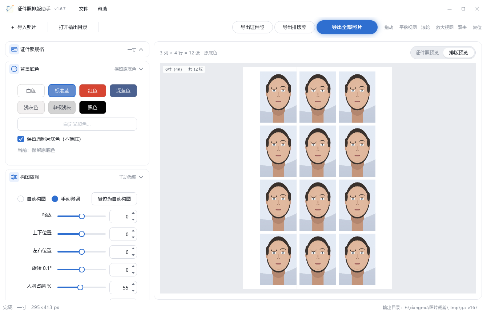

# 证件照排版助手

Windows 桌面证件照工具：导入一张照片，选择尺寸与底色，自动或手动构图，再导出单张证件照和相纸排版。当前源码版本 **v1.6.12**。

照片和人脸推理在本机处理，应用不上传照片。联网功能包括缺失模型下载、更新元数据查询及用户触发的更新包下载；关闭“启动时自动检查更新”只关闭自动查询，不会关闭其他联网操作。



涉及照片的截图和测试使用 `scripts/make_demo_face.py` 绘制的合成人像，不含真人示例照片。v1.6.12 的[原生下拉菜单截图](screenshots/v1.6.12-options.png)和[动画操作录制](screenshots/v1.6.12-motion.gif)另附，录制展示下拉、快速反向切换和任务进度。

## 主要功能

- **规整的选项与平顺动效**：寸数规格集中置顶，两种二寸相邻；卡片、下拉框、预览胶囊和进度反馈采用统一阻尼曲线，快速反向接续当前位置与速度，结束后停止动画。滚动到下部收起时保持上方标题稳定。
- **可靠的下拉交互**：外部按钮和其他下拉框一次点击生效；关闭期间只确认一次选择，Esc取消后不会误提交。支持方向键、输入文字检索、Enter/Space确认、Esc/Alt+↑取消和Tab切换焦点，数据或所属控件变化时关闭过期菜单。
- **进度反馈**：等待光带自动平滑往返，已知进度平滑到达最新值；按实际经过时间播放，隐藏、禁用或完成后停止计时。
- **大连续圆角与胶囊**：控件、卡片及弹窗的连续曲率圆角加大；导出按钮、预览切换、滑条轨道、滚动条滑块和进度条保留半圆两端的胶囊，原有文字和控件尺寸保持。Windows亚克力窗口恢复实际生效的DWM系统圆角；系统不支持时关闭亚克力并使用32px连续曲线透明外轮廓。系统文件选择器及安装器外观由系统控制。
- **保留导出结果**：界面文件名明确区分中文规格、尺寸与底色，同名自动编号；每次结果独立保存，导出后自动打开输出目录。
- **一次一张**：新导入或拖入的照片替换上一张；处理期间仍可换图，只发布最新请求的结果。同一路径的文件再次导入也重新读取。
- **换底或保留原底色**：可选白、蓝、红等预设与自定义颜色；勾选“保留原照片底色（不换底）”后，从原图对应区域取样，颜色按钮停用。开关、颜色和手动构图复用已完成的推理结果。
- **构图**：自动构图、缩放、位置、旋转、脸部比例微调。切回自动会恢复自动结果。滚轮/拖动仅缩放和平移查看，Ctrl+拖动调整构图。
- **排版**：5/6/7寸、A4、A3；纸张与照片统一按输出DPI从毫米换算；比较原方向及整体90°旋转网格，张数相同时优先原方向。不是混合方向装箱算法。
- **裁切线**：贯穿线、独立方框或无；线位于照片边界，不在间距中线。旋转方案会真实旋转照片内容。
- **导出**：JPEG/PNG；写入并回读DPI，改变输出DPI时同步改变像素。每张照片有像素量化误差，打印时仍需选择“实际尺寸”，关闭驱动缩放。
- **文件大小约束**：单图按规格和用户上限编码；整版不继承单张报名文件的KB限制。无法满足约束会明确报告。PNG保留alpha，JPEG将alpha合成到白底；合法填充位于文件结束标记之前。
- **设置**：输出目录和原底色开关持久化；写入失败会提示，采用同目录临时文件与原子替换保留已有配置。

“保留原底色”保留的是背景内容，不是原文件字节：仍会按尺寸裁剪、缩放，手动模式可旋转。管线保留归一化后的原图（长边最多2000像素）；超出原图边界的区域复制边缘像素。它仍需要人脸检测和模型，不是无需推理的直接裁图工具。

## 规格与来源

库中有40条照片预设，保留既有ID以兼容配置和CLI。来源等级只表示记录的证据类型，不保证当前业务受理。本轮重点复核如下：

| 名称 | 宽×高毫米 | 300dpi宽×高像素 | 说明 |
|---|---|---|---|
| 一寸 | 25×35 | 295×413 | 专业技术资格考试平台的特定官方要求；还须使用其官方审核工具 |
| 二寸（35×53mm） | 35×53 | 413×626 | 魔方裁判注册等业务；南京婚登也用此尺寸，但为双人合影 |
| 二寸（35×49mm） | 35×49 | 413×579 | 湘桥区特定中医医师资格考核材料；旧名“简历照（宽版）”仍可搜索 |
| 三寸 | 55×84 | 650×992 | 仅有商业服务参考，D级，未确认为通用官方标准 |

[完整来源、日期、业务范围与冲突记录](docs/research/photo-size-sources.md)。二寸的两种尺寸各自保留，不能只靠“寸名”选规格。NCRE改正为宽144×高192，名称注明2022北京像素口径；2026北京页面存在单位冲突，保留提示，不能作为当期合规保证。其他历史预设没有在本轮逐项重新联网核实。

## 快速开始

需要Windows 10/11及Python 3.11。界面的Win32效果只在Windows验证。

```powershell
python -m venv .venv
.\.venv\Scripts\python.exe -m pip install -r requirements.txt -r requirements-dev.txt
# 源码仓库不含权重；首次使用前准备模型
powershell -ExecutionPolicy Bypass -File scripts\download_weights.ps1
.\.venv\Scripts\python.exe app\main.py
```

界面操作见[使用说明](使用说明.md)。三种打包形态为便携文件夹zip、安装包和单文件exe。当前打包配置包含MODNet模型；模型缺失时才需要下载引导。单文件版启动需解压运行库，通常比文件夹版慢，不承诺固定启动秒数。

CLI示例：

```powershell
.\.venv\Scripts\python.exe -m app.cli --plan --spec cn_yicun --paper 6inch --dpi 350
.\.venv\Scripts\python.exe -m app.cli --input photo.jpg --spec cn_yicun --paper 6inch --keep-background --out 输出
```

单图大小上限用 `--kb`，整版独立用 `--layout-max-kb`。`--keep-background`接入同一原底色管线。

## 测试与本地构建

```powershell
$env:QT_QPA_PLATFORM='offscreen'
$env:IDPHOTO_NO_UPDATE='1'
.\.venv\Scripts\python.exe -m pytest --basetemp=_tmp/pytest
.\.venv\Scripts\python.exe scripts\audit_specs.py
# 仅本地生成，避免构建过程向节点发布
.\scripts\package_release.ps1 -SkipNode
.\scripts\verify_build.ps1
.\scripts\verify_splash.ps1
.\scripts\verify_installer.ps1
```

回归覆盖真实QThread排队与旧结果丢弃、自动/手动恢复、原底色预览/导出一致、输出尺寸/裁线/旋转、格式/DPI/大小约束、中文路径与设置原子保存。部分生命周期测试用受控推理器隔离时序；另有实际MODNet合成人像测试。软件测试不能替代打印实测或报名受理审核。

打包脚本清理旧版本产物，构建单文件与文件夹载荷，检查Qt插件/模型/规格库，生成zip及Inno安装包并收集校验。只带公开说明，不打包内部计划书。版本源为 `app/__init__.py`，安装器版本需同步。

## 自动更新与节点

程序保留GitHub、镜像及静态 `update.json` 节点更新功能。源选择比较的是元数据响应延迟，**不是完整下载吞吐量**。SHA256只在元数据提供摘要时校验；当前默认自建节点使用HTTP，不能视为签名更新。

```json
{ "update_sources": ["http://8.133.208.128/update/update.json"] }
```

`package_release.ps1` 不带 `-SkipNode` 时会尝试生成清单并推送自建节点；不等于已同步GitHub，也不等于完成发布前验收。维护者应先用 `-SkipNode` 构建和验收，再明确发布。`make_update_manifest.py` 和 `push_update_node.py` 用于后续节点同步，SSH凭据不存入仓库。

本轮只修复了关闭时等待线程、阻止晚到回调重开窗口，未重新实证受保护安装目录下的整套在线更新/UAC/中断回滚；不作无损回滚保证。下载时主界面隐藏，替换由独立合并进程执行。旧版1.6.3/1.6.4的参数缺陷可能需要手动安装跨过。

## 目录与已知限制

- `app/core/`：规格、排版、处理、编码、设置与更新逻辑；`app/ui/`：PySide6界面。
- `app/vendor/hivision/`：Apache-2.0上游内核副本；[补丁记录](docs/vendor-patches.md)。
- `tests/`：回归测试；`scripts/`：审计/打包/验收；`packaging/`：PyInstaller/Inno配置。
- 默认输出和日志优先在程序目录；无写权限时部分目录回退用户路径，详见 `app/paths.py`。不承诺完全不写系统盘或注册表（安装器会登记卸载信息）。
- 一次仅处理一个人脸；极端发丝、遮挡、透明头纱及原图边界不足可能影响效果。保留原底色不会修复原有背景瑕疵。
- Windows资源管理器跨权限拖放、真实打印尺寸和外部报名系统审核仍需在实际环境确认。

## 许可、用途与版本

本项目自有代码采用[MIT](LICENSE)，第三方许可及用途说明见[NOTICE.md](NOTICE.md)。源码仓库不含模型权重与字体；构建载荷与源码仓库的分发范围不同。第三方组件包括HivisionIDPhotos、MODNet、MTCNN、PySide6/Qt、OpenCV、ONNX Runtime、Pillow和NumPy等。

仅用于合法的证件照制作，不得用于伪造证件或身份冒用。规格不替代受理单位现行要求；软件按现状提供，不承诺审核通过、打印结果或特定用途适用性。

变更见[CHANGELOG.md](CHANGELOG.md)，本轮动画与下拉交互证据见[v1.6.12 验证记录](docs/validation-v1.6.12.md)；处理与规格重构证据见[v1.6.7 验证记录](docs/validation-v1.6.7.md)。
