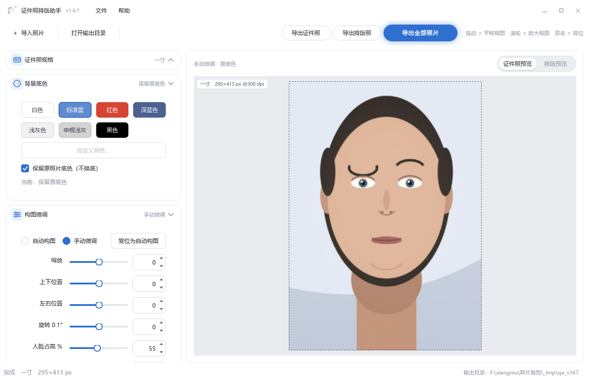
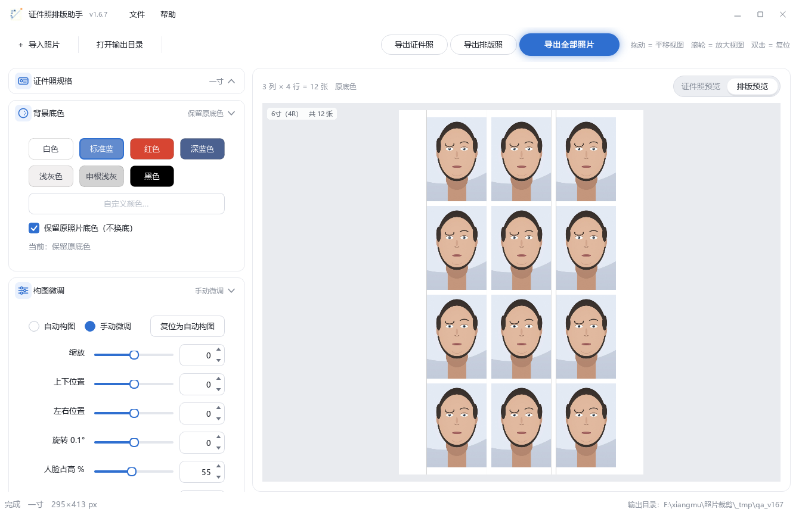

# v1.6.7 本地验证记录

日期：2026-11-20。范围是本次源码、测试、文档及Windows本地构建；本记录不代表已发布GitHub Release或更新节点，也不代表第三方受理系统认证。

## 已执行及结果

| 检查 | 实际结果 | 说明 |
|---|---|---|
| 全量pytest | 292项通过，退出码0，无跳过标记 | `QT_QPA_PLATFORM=offscreen`、`IDPHOTO_NO_UPDATE=1`；临时输出放项目`_tmp/pytest_full` |
| 测试计数复核 | collect-only共292项 | 防止把新增子集数误当全量；核心布局/编码/CLI子集为139项 |
| 规格审计 | 40条，0处毫米/像素不自洽 | 容差1px；中国常用分类无重复物理尺寸；不是全库当期业务要求认证 |
| 编译/差异检查 | compileall、git diff --check通过 | 行尾转换提示不等于差异错误；审计脚本的GBK无法编码勾号已换为ASCII标记 |
| 源码界面取证 | 真实MODNet合成人像，单图295×413、原底色开关与12张排版 | Qt离屏渲染后人工查看截图；不当成资源管理器拖放实测 |
| 本地构建 | 单文件exe、文件夹zip、Inno安装包生成成功 | 使用`package_release.ps1 -SkipNode`，本轮不自动推节点；载荷包含模型 |
| 冻结版自测 | 单文件与文件夹均PASS，frozen=true，退出码0 | 清理PATH并设失效HTTPS代理；分别产生单张和6寸排版JPEG；加载规格、模型、内核及处理链通过 |
| 原生GUI冒烟 | 两种形态均PASS | 找到可见Qt主窗，无Tk启动窗；发送WM_CLOSE后进程组正常退出，无本轮_MEI目录残留 |
| 安装/卸载 | ROUND TRIP PASS | 安装到项目盘临时目录；检查卸载注册项和开始菜单；安装后自测；卸载后文件、注册项、快捷方式清理通过 |
| 文件收集 | SHA256逐项对照 | 最终交付目录按公开清单重建；三种程序与公开文档拷贝源一致，内部计划书不在交付白名单 |

冻结自测首轮用时：单文件5.8秒、文件夹2.5秒。原生主窗出现：文件夹5.8秒、单文件5.5秒。这只是当前机器的一次观察，不是性能保证。

### 可复核命令

```powershell
$env:QT_QPA_PLATFORM='offscreen'
$env:IDPHOTO_NO_UPDATE='1'
.\.venv\Scripts\python.exe -m pytest -q --maxfail=4 --basetemp=_tmp/pytest_full
.\.venv\Scripts\python.exe -m pytest --collect-only -o addopts= -q
$env:PYTHONIOENCODING='utf-8'
.\.venv\Scripts\python.exe scripts\audit_specs.py
.\.venv\Scripts\python.exe -m compileall -q app tests scripts
.\scripts\package_release.ps1 -SkipNode
.\scripts\verify_build.ps1
.\scripts\verify_splash.ps1
.\scripts\verify_installer.ps1
```

安装验收脚本会在发现已有同AppID安装记录或开始菜单快捷方式时中止，避免覆盖现有安装；需要干净的测试用户配置。此轮没有既有冲突。验收只涉及所启动的进程，不按进程名批量结束用户程序。

## 主要防回归证据

- `tests/test_request_flow.py`使用真实`ProcessWorker` QThread、排队信号和受控推理器：A→B→C时丢弃A、跳过尚未开始的B，处理最新C；同路径换内容重读；切规格和空洞选项取最新请求；当前背景/原底色/手动设置用于渲染；失败清空和恢复；关闭等待线程；预览与导出取同一成品；重建布局保留状态。
- `tests/test_crop_geometry.py`验证源图精确切片、像素中心、原图/抠图同几何旋转、透明输出、极小缩放仅分配目标尺寸、无效参数默认值、缺失/不匹配源图错误，以及并发空洞设置的串行化与异常恢复。
- `tests/test_pipeline.py`用实际模型和合成人像验证来源图在换底处理后仍保留，原底色自动/手动路径可用。它不是在所有真人、发丝和遮挡条件上的质量测试。
- `tests/test_layout.py`验证统一DPI、真实顺时针旋转、精确照片边界与纸边裁线、无旋转优先的平局策略、非法几何参数。
- `tests/test_exporter.py`验证JPEG EXIF/JFIF与PNG pHYs回读、分数/厘米单位DPI、JPEG白底合成/PNG透明、合法结束标记前填充及CRC、目录、严格大小边界和不可满足的限制。
- `tests/test_cli.py`以受控推理结果验证实际图片保存/回读、DPI覆盖、原底色标志和单图/整版KB隔离；CLI测试不等于实际模型质量测试。
- `tests/test_settings.py`直接验证真实路径模块导入、保存持久化、原子替换失败保留旧文件、临时文件清理和布尔选项。

## 界面证据

以下使用项目绘制的合成人像，手动构图，折叠规格卡以展示原底色开关。默认卡片状态未为截图改变到源码中。





## 来源与仍未实证的范围

[尺寸来源对照](research/photo-size-sources.md)保留来源、发布日期、业务范围和差异。35×49及35×53各自有特定业务官方证据；55×84三寸仅商业参考。NCRE存为2022北京的宽144×高192像素下限，并保留2026北京页面单位冲突；不自行判定笔误。

以下不在本轮实证结论内：

- 其余35条历史规格没有逐项重新联网核验；任何预设均不保证当期受理通过。
- 真实打印机/驱动的100%输出、相纸与裁切误差、外部报名审核，以及普通/提权资源管理器的端到端拖放。
- 受保护安装目录的整套在线更新、UAC、网络中断与覆盖中断回滚。本轮冻结自测不是在线升级测试；默认HTTP节点与可选摘要不是签名信任链。
- 首次缺模型下载与升级进度窗口的完整跨进程体验未在本轮重新验收。当前包内置MODNet，不能用成功启动反推下载引导已通过。
- 原底色保留归一化源图内容，仍有裁剪/缩放/旋转及越界边缘复制；不是无损复制原文件，也不会消除原背景瑕疵。
- 排版比较两种统一方向网格，不做横竖混排，不声称全局装箱最优。
- `build_vendor.py`仅自动重放PATCH-1至4，PATCH-5须人工迁移；日常构建使用当前已修改副本，见[补丁记录](vendor-patches.md)。

自测时观测到C盘空闲空间有不足1MB的波动，不能据此证明完全没有系统盘写入。安装器明确写入并清理用户注册表/开始菜单项。工作产物、构建缓存与测试图片尽量放项目盘，未对操作系统或第三方库作零写入承诺。
